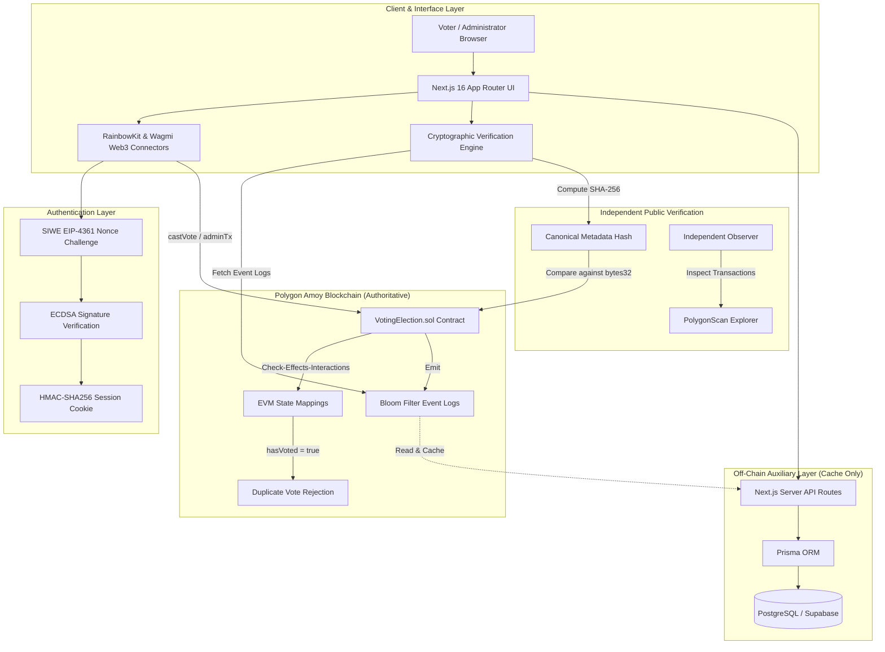
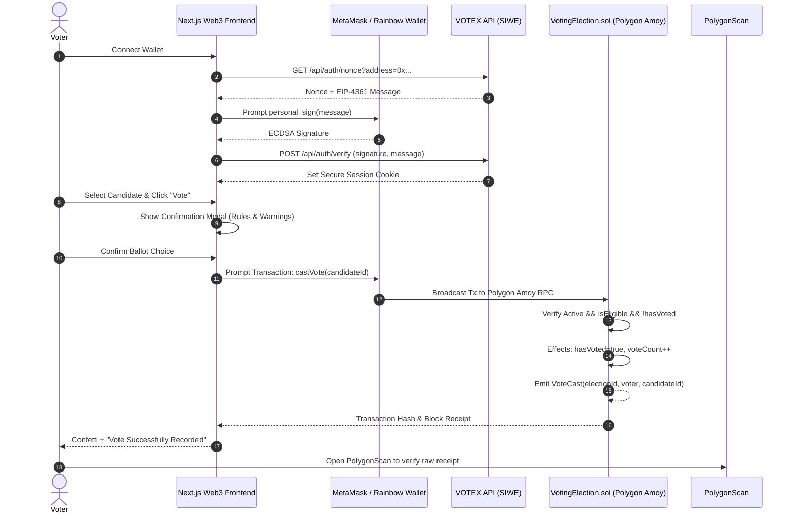
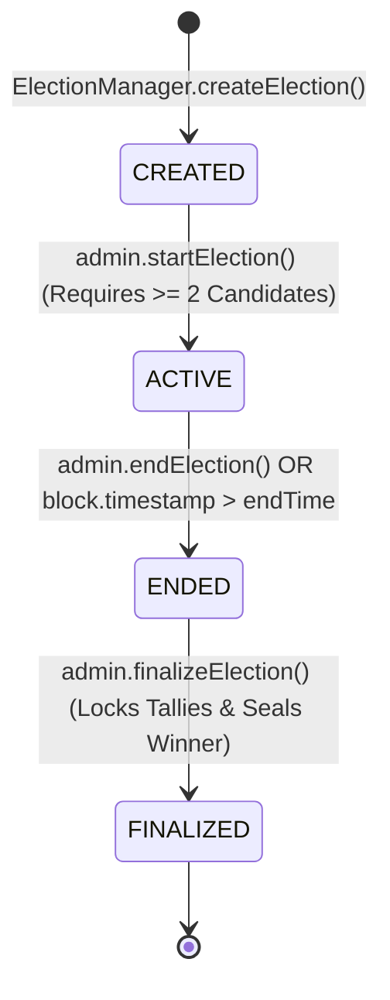

# VOTEX — Architecture Specification

> **"Vote Once. Verify Everything. Trust No One."**

---

## 1. High-Level System Architecture

VOTEX implements a strict separation between **authoritative blockchain state** and **off-chain indexing/metadata caching**. The blockchain EVM smart contract is the sole source of truth for vote counts, eligibility status, and lifecycle transitions.

---

## 2. Separation of Architectural Concerns

To adhere to institutional-grade security principles, VOTEX delineates 5 decoupled stages:

| Stage | Responsibility | Enforcement Mechanism |
| :--- | :--- | :--- |
| **1. Voter Identity / Whitelist** | Registering approved voter wallets | Admin invokes `registerVoter(address)` on-chain |
| **2. Voting Authorization** | Verifying wallet ownership & eligibility | SIWE signature challenge + contract `isVoterEligible` check |
| **3. Vote Recording** | Atomically tallying ballot & locking voter | `castVote(candidateId)` with Checks-Effects-Interactions |
| **4. Public Verification** | Independent confirmation by voters & auditors | Direct RPC event inspection & PolygonScan transaction receipts |
| **5. Election Administration** | State machine lifecycle & candidate registry | `onlyAdmin` access-controlled methods with custom errors |

---

## 3. Sequence Diagram: Voting UX Flow

---

## 4. Database Trust Boundaries

A critical requirement of VOTEX is that **the database is never trusted for voting calculations**:

1. **No Silent State Changes:** If an attacker gains full root access to PostgreSQL and changes candidate vote counts in the database table, the UI and public audit tools immediately flag the discrepancy by re-reading the authoritative total directly from the smart contract via `publicClient.readContract()`.
2. **Metadata Integrity Guarantee:** Off-chain descriptions and candidate manifestos are pinned via deterministic canonical JSON and committed to the blockchain as an immutable `bytes32 metadataHash`. Any off-chain database modification causes immediate SHA-256 hash mismatch alerts.

---

## 5. State Machine Lifecycle

