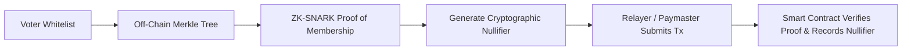

# VOTEX — Privacy Boundaries & Cryptographic Roadmap

> **"Vote Once. Verify Everything. Trust No One."**

---

## 1. Transparency Notice: Public Blockchain Privacy Boundaries

**IMPORTANT DISCLOSURE:**
VOTEX is an educational and collegiate digital voting platform. The MVP version **DOES NOT** provide secret-ballot anonymity if a participant's wallet address is known or correlated with their real-world identity.

### 1.1 The Pseudonymity Tradeoff in Public Blockchains
On a public EVM blockchain like Polygon Amoy:
1. Every transaction contains the sender's public address (`from: 0x...`).
2. The function parameters (`candidateId: uint256`) are transmitted within the transaction `data` payload.
3. Emitted event logs (`VoteCast(electionId, voter, candidateId, timestamp)`) are stored in transaction receipts and indexed by bloom filters.

**Consequently:**
If a university registrar or peer knows that address `0x7099...` belongs to student Alice, they can inspect PolygonScan and observe Alice's candidate selection.

We deliberately avoid implementing pseudo-cryptographic "client-side obfuscation" or claiming fake anonymity. Instead, we explicitly document this boundary and define the cryptographic roadmap required for production-grade secret balloting.

---

## 2. What the MVP Delivers Today

While not secret-ballot anonymous, the VOTEX MVP provides five critical guarantees that centralized web apps cannot match:

1. **Non-Repudiation:** A voter cannot deny having cast a ballot once signed with their ECDSA private key.
2. **Tamper-Evident Records:** No administrator or server owner can retroactively delete, swap, or artificially inject votes.
3. **One-Person-One-Vote Enforcement:** The EVM prevents double-voting mathematically via state machine mapping checks.
4. **Independent Auditing:** Observers can replay the event log directly from Polygon consensus blocks without trusting the server.
5. **Election Integrity Hash:** Off-chain election rules are locked to an immutable SHA-256 hash stored on-chain.

---

## 3. Cryptographic Privacy Roadmap: Future Production Architecture

To achieve true secret-ballot voting with coercion resistance, the next version of VOTEX will integrate zero-knowledge cryptographic primitives:

### 3.1 Merkle Tree Voter Sets
Instead of storing public wallet addresses on-chain in `mapping(address => bool)`, voter commitments (e.g. `commitment = Poseidon(secretKey)`) are compiled into an off-chain Merkle tree. Only the **Merkle Root** is stored on the smart contract.

### 3.2 Zero-Knowledge Proofs (zk-SNARKs)
Using Circom or Halo2 zero-knowledge circuits, a voter proves:
1. *"I know a secret that belongs to a leaf in the verified Merkle tree."*
2. *"My ballot selection is a valid candidate ID."*
3. *"The proof is valid for this specific election ID."*

All without revealing **which** leaf they belong to or **who** they are.

### 3.3 Cryptographic Nullifiers
To prevent double voting without identifying the voter, the circuit outputs a deterministic nullifier:
$$\text{Nullifier} = \text{Poseidon}(\text{secretKey}, \text{electionId})$$

The smart contract verifies that `nullifiers[Nullifier] == false`, records the nullifier as spent, and increments the candidate tally. Because the nullifier cannot be reverse-engineered to the voter's identity, the vote remains completely secret.

### 3.4 Gasless Relayers & Coercion Resistance (MACI)
To decouple transaction gas payments from the voter's address, transactions are submitted via ERC-4337 Account Abstraction paymasters or gasless relayers. For high-stakes elections, Minimum Anti-Collusion Infrastructure (MACI) encryption allows voters to change their key if coerced, ensuring that bribers cannot verify how the vote was cast.
